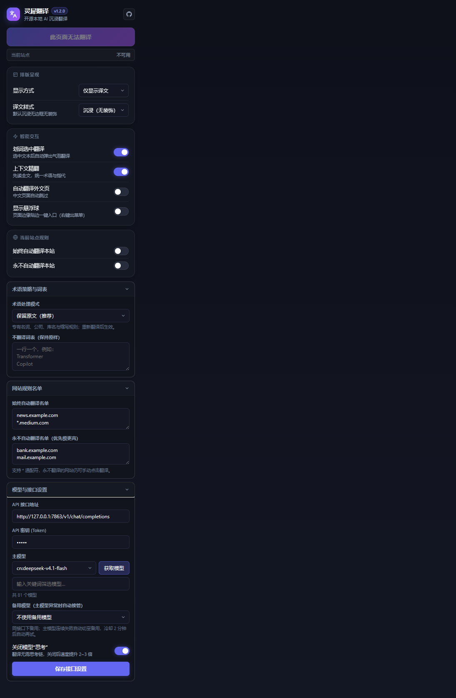

<div align="center">

# 灵犀翻译 (Lingxi Translate)

**懂上下文、懂专业术语的纯净开源 AI 沉浸翻译浏览器扩展**

*基于本地大模型（DeepSeek / Ollama / vLLM / OpenAI 兼容接口）打造，100% 隐私零追踪，零商业套路。*

[](LICENSE)
[](manifest.json)
[](manifest.json)
[](https://github.com/Ningnuo-Sama/Lingxi-Translate/pulls)

[English](#features-en) | [简体中文](#核心特性) | [快速上手](#快速上手) | [配置示例](#网关与模型配置)

</div>

---

## 为什么做灵犀翻译？

市面上的翻译扩展往往充斥着商业付费墙、额度限制、隐私数据回传或生硬的逐句词典直译。而在阅读长篇技术文档、论文和资讯时，我们真正需要的是：

1. **懂上下文**：长篇大论中，前文出现的缩写、代词和行业背景，后文必须准确对应。
2. **懂术语**：专有名词、框架库名（如 `Kubernetes`、`Transformer`、`Copilot`）和人名应保留英文，不强行机械汉化。
3. **真正沉浸**：译文自然融入网页版面，表格与卡片排版单行对齐，不把网页结构撑裂撕扯。
4. **数据自主**：直连本地部署的 DeepSeek 或开源模型网关，翻译速度快（免思考链 2 秒内回填），不留痕迹。

**灵犀翻译 (Lingxi Translate)** 由此而生——取意“心有灵犀一点通”，完全开源自研。

---

## 核心特性

- 🧠 **全局上下文精翻 (Context-Aware)**：翻译前提取文档摘要与核心概念，批次翻译时维护滑动上下文窗口，彻底消除长文指代不明与前后术语译法冲突。
- 🎯 **沉浸式单行排版 (True Immersion)**：默认仅译文模式，原地无损替换原文。特殊布局（如表格单元格、卡片列表）原生适配单行行高（28px），不产生上下双行堆叠，亦支持快捷切换双语对照。
- 📖 **三档术语策略 (Smart Terminology)**：
  - **保留原文 (Keep)**：人名、公司、产品、库名、缩写及无通行译名的专业术语保留英文；通行概念与地名翻译。
  - **首次括注 (Gloss)**：整页首次出现时采用 `中文译名（Original）`，后文统一使用译名。
  - **常规翻译 (Translate)**：全量意译。支持多行自定义「永远不翻译词表」。
- ⚡ **视口懒翻译与预取 (Lazy Viewport & Prefetch)**：进入视口区域才触发翻译，并向下提前预取 2 屏，滚动前译文已准备就绪；支持单页应用（SPA）与动态内容自动监听。
- 🎈 **贴边独立悬浮球 (Shadow DOM Float Ball)**：完全隔离于页面 DOM 之外，鼠标左键一键开关翻译，右键呼出快捷设置面板，不悬停误弹，不挡视线。
- 🛡️ **高韧性容灾机制 (Built-in Resilience)**：内置全局并发限流（防 503）、瞬时错误指数退避重试、主备模型断路器切换与自动冷却自愈。
- 🔒 **100% 隐私与纯净**：全链路本地网络直连，零外部遥测，无埋点无打点。

---

## 界面展示

<div align="center">
  
</div>

---

## 快速上手

### 1. 克隆代码仓库

```bash
git clone https://github.com/Ningnuo-Sama/Lingxi-Translate.git
```

### 2. 加载到浏览器

灵犀翻译基于标准 **Chrome Manifest V3** 开发，完美兼容所有 Chromium 内核浏览器（Google Chrome、Microsoft Edge、Brave、Arc 等）：

1. 打开浏览器，访问扩展管理页面：
   - Chrome / Brave: `chrome://extensions`
   - Edge: `edge://extensions`
2. 开启页面右上角的 **「开发者模式」 (Developer mode)**；
3. 点击 **「加载已解压的扩展程序」 (Load unpacked)**；
4. 选择刚刚克隆的 `Lingxi-Translate` 文件夹即可完成安装。

---

## 网关与模型配置

点击浏览器右上角的扩展图标呼出设置弹窗：

### 常见后端配置示例

| 模型后端 | API 接口地址 (`apiUrl`) | API 密钥 (`apiKey`) | 推荐主模型 (`model`) |
|---|---|---|---|
| **本地 DeepSeek 网关** | `http://127.0.0.1:7863/v1/chat/completions` | `admin` (弱口令/空) | `cn:deepseek-v4.1-flash` |
| **Ollama (本地)** | `http://127.0.0.1:11434/v1/chat/completions` | `ollama` | `qwen2.5:7b` / `deepseek-r1:8b` |
| **vLLM / SGLang** | `http://127.0.0.1:8000/v1/chat/completions` | 自定义 Token | 载入的模型名称 |
| **OneAPI / NewAPI** | `http://127.0.0.1:3000/v1/chat/completions` | 渠道 Token | 目标模型 ID |

> 💡 **速度优化建议**：在弹窗的「模型与接口设置」中勾选 **「关闭模型思考」**。翻译任务无需长思维链推理，关闭思考后每批响应速度可从 4~7 秒压缩至 1.5~2.2 秒，显著降低延迟。

---

## 常用快捷键

- `Alt + A`：快速开启 / 恢复当前标签页整页翻译。

---

## 自动化测试与质量保障

项目内置完整的全链路端到端自动化测试套件（基于 Node.js 与 Playwright），覆盖真实 Chromium 浏览器与真实本地模型链路：

```bash
# 1. 术语三档与词表断言
node tests/node_term_modes.js

# 2. 备用模型断路器切换与冷却
node tests/node_fallback_breaker.js

# 3. 后台服务回收自愈与任务断连测试
node tests/node_job_lost.js

# 4. 真实浏览器端到端全流程（整页/懒加载/表格/弹窗控件）
python -X utf8 tests/e2e_page_flow.py

# 5. 悬浮球交互、右键菜单、网站规则优先级（21 项全量断言）
python -X utf8 tests/e2e_float_rules_fallback.py
python -X utf8 tests/check_float_result.py
```

---

## 协议与致谢

- 遵循 [MIT License](LICENSE) 开源协议。
- 欢迎提交 Issue 或 Pull Request，共同打造更纯净好用的开源 AI 网页翻译工具。
